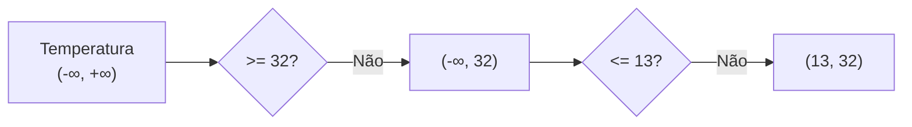

# Condicionais

As estruturas condicionais nos possibilitam **avaliar condições** e executar diferentes códigos dependendo de seus resultados - **alterando o fluxo do código**. Para deixar essa explicação mais clara, vamos pensar em um exemplo do dia a dia: será que eu devo levar o meu guarda-chuva ao sair de casa? Ao avaliarmos essa pergunta, primeiro pensamos se irá chover ou não no dia. **Se** chover, então pegamos o guarda-chuva, **senão** deixamos ele em casa.

## if e else

Para resolvermos o nosso problema do guarda-chuva, vamos escrever um programa que irá fazer essa decisão! Primeiro iremos declarar uma variável do tipo `#!c bool`, chamada `vai_chover`; damos o valor `#!c true` para ela. Depois iremos implementar essa lógica do **"se e senão"**.

!!! atenção

    Não se esqueça de importar a definição do tipo `#!c bool` com o header `<stdbool.h>`.

```c
#include <stdbool.h>
#include <stdio.h>

int main(void)
{
    bool vai_chover = true;

    if (vai_chover)
    {
        printf("Vai chover!\n");
        printf("É melhor levar o guarda-chuva.\n");
    }
    else
    {
        printf("Deixe o guarda-chuva em casa, não irá chover hoje.\n");
    }

    return 0;
}
```

As palavras `#!c if` e `#!c else` são traduções diretas para o "se" e "senão".
Com isso em mente, lemos esse código da seguinte forma: **se** o valor armazenado na variável `vai_chover` for `#!c true`, **então** execute tudo entre as chaves abaixo do `#!c if`, senão, execute tudo entre as chaves abaixo do `#!c else`.

Mude o valor da variável `vai_chover` para `#!c false` e veja como a saída muda.

## Operações Relacionais

Agora vamos pensar em outro exemplo: notificar um aluno se ele passou ou está de recuperação em uma matéria.
Esse exemplo vai nos ajudar a trabalhar as chamadas **operações relacionais**, as operações como "menor que" ($\lt$) e "maior ou igual" ($\ge$) da matemática.

Na maioria das escolas, o aluno precisa tirar **6 ou mais** para passar, caso contrário ele reprova ou fica de recuperação. Usamos a operação **"maior ou igual"** (`#!c >=`) da matemática para transmitir essa ideia. No código a seguir declaramos uma variável do tipo `#!c double` que representa a nota do aluno e verificamos se ele passou ou não:

```c
#include <stdio.h>

int main(void)
{
    double nota = 5.0;

    if (nota >= 6.0)
    {
        printf("Você passou!\n");
    }
    else
    {
        printf("Ficou de recuperação :(\n");
    }

    return 0;
}
```

Da mesma forma que podemos pensar que o aluno *passa* na matéria ao tirar **6 ou mais**, pensar que o aluno *reprova* ao tirar **menos que 6** também é válido. Usamos o **"menor que"** (`#!c <`) para alterar a lógica do código, mas mantendo o mesmo resultado:

```c
#include <stdio.h>

int main(void)
{
    double nota = 5.0;

    if (nota < 6.0)
    {
        printf("Ficou de recuperação :(\n");
    }
    else
    {
        printf("Você passou!\n");
    }

    return 0;
}
```

Fiz essa mudança para mostrar o operador "menor que", mas ela também serve para mostrar que certas operações relacionais possuem uma equivalência entre si.

Ainda temos a operação de **igualdade**, representada com **dois sinais de igual**, ou seja, `#!c ==`. Vamos exibir uma mensagem especial para o aluno que tire 10 - adicionando um **novo `#!c if`**:

```c hl_lines="15-18"
#include <stdio.h>

int main(void)
{
    double nota = 5.0;

    if (nota < 6.0)
    {
        printf("Ficou de recuperação :(\n");
    }
    else
    {
        printf("Você passou!\n");

        if (nota == 10.0)
        {
            printf("E parabéns por tirar 10!\n");
        }
    }

    return 0;
}
```

O professor da turma quer incentivar os alunos que ficaram de recuperação, deixando claro que eles podiam ter tirado `#!c 0`! Em C, usamos a operação de **desigualdade** ($\ne$), escrita como `#!c !=`, para transmitir essa ideia:

```c hl_lines="11-18"
#include <stdio.h>

int main(void)
{
    double nota = 5.0;

    if (nota < 6.0)
    {
        printf("Ficou de recuperação :(\n");

        if (nota != 0.0)
        {
            printf("Mas podia ter sido 0 ;)\n");
        }
        else
        {
            printf("...\n");
        }
    }
    else
    {
        printf("Você passou!\n");

        if (nota == 10.0)
        {
            printf("E parabéns por tirar 10!\n");
        }
    }

    return 0;
}
```

## Operações Booleanas

### "E"

O professor percebeu que os alunos estão indo muito mal na prova. Ele decidiu usar a frequência às aulas como outro fator que faz o aluno passar na matéria.
A taxa de frequência vai de 0 a 10, e segue esta lógica: se o aluno tirou menos que 6, mas possui frequência maior ou igual a 9, ele passa, do contrário ele reprova. Criamos uma nova variável também do tipo `#!c double` chamada `frequencia` e a usamos da seguinte forma:

```c hl_lines="10"
#include <stdio.h>

int main(void)
{
    double nota = 5.0;
    double frequencia = 10.0;

    if (nota < 6.0)
    {
        if (frequencia >= 9.0)
        {
            printf("Você passou!\n");
        }
        else
        {
            printf("Você reprovou...\n");
        }
    }
    else
    {
        printf("Você passou!\n");
    }

    return 0;
}
```

Note que temos que repetir duas vezes a mensagem `"Você passou!"`. A linguagem C nos oferece os chamados **operadores booleanos**, que são operações que resultam em apenas `#!c true` ou `#!c false` a partir de uma **relação lógica**. Nesse caso, a relação lógica é o "E", ou seja, para o aluno **reprovar** é necessário que *ele tire menos que 6* **e** *tenha frequência menor que 9*. Escrevemos essa operação como `#!c &&`:

```c hl_lines="8"
#include <stdio.h>

int main(void)
{
    double nota = 5.0;
    double frequencia = 10.0;

    if (nota < 6.0 && frequencia < 9.0)
    {
        printf("Você reprovou...\n");
    }
    else
    {
        printf("Você passou!\n");
    }

    return 0;
}
```

Basta que uma dessas condições seja falsa para que o aluno passe na matéria, ou seja, basta que sua nota seja maior ou igual a 6 **ou** sua frequência seja maior ou igual a 9 para que ele passe. A tabela a seguir, chamada de **tabela-verdade**, deixa clara essa relação. A coluna **Resultado** indica o que é passado para o `#!c if`:

| `#!c nota < 6.0` | `#!c frequencia < 9.0` | **Resultado** |
| :-: | :-: | :- |
| **`#!c true`** | **`#!c true`** | **`#!c true`** |
| `#!c true` | `#!c false` | `#!c false` |
| `#!c false` | `#!c true` | `#!c false` |
| `#!c false` | `#!c false` | `#!c false` |

### "OU"

No parágrafo anterior, vimos que se o aluno tiver *nota maior ou igual a 6* **ou** *frequência maior ou igual a 9* ele **passa**. O C possui o operador "OU", escrito como `#!c ||`, que traz essa ideia:

```c hl_lines="8"
#include <stdio.h>

int main(void)
{
    double nota = 5.0;
    double frequencia = 10.0;

    if (nota >= 6.0 || frequencia >= 9.0)
    {
        printf("Você passou!\n");
    }
    else
    {
        printf("Você reprovou...\n");
    }

    return 0;
}
```

Basta que uma condição seja verdadeira para que o resultado seja verdadeiro:

| `#!c nota >= 6.0` | `#!c frequencia >= 9.0` | **Resultado** |
| :-: | :-: | :- |
| **`#!c true`** | **`#!c true`** | **`#!c true`** |
| **`#!c true`** | **`#!c false`** | **`#!c true`** |
| **`#!c false`** | **`#!c true`** | **`#!c true`** |
| `#!c false` | `#!c false` | `#!c false` |

---

O professor percebeu uma melhora nas notas dos alunos e decidiu fazer uma excursão para o cinema. O problema é que o cinema é muito novo e eles ainda não têm um sistema de **verificação de meia-entrada**. Têm direito a pagar meia-entrada:

- Idosos com 60 anos ou mais.
- Crianças com até 12 anos.
- E estudantes (na escola ou faculdade).

Com o que vimos até agora, crie um programa que resolva esse problema antes de continuar.

??? resposta

    Basta usarmos o "OU" duas vezes, combinando as três condições:

    ```c hl_lines="9"
    #include <stdio.h>
    #include <stdbool.h>

    int main(void)
    {
        int idade = 10;
        bool esta_estudando = true;

        if (idade >= 60 || idade <= 12 || esta_estudando)
        {
            printf("Você paga meia!\n");
        }
        else
        {
            printf("Você paga inteira!\n");
        }

        return 0;
    }
    ```

À medida que fazemos mais verificações, é interessante darmos um **nome** para elas. Podemos criar três variáveis do tipo `#!c bool` chamadas `eh_idoso`, `eh_crianca` e `tem_meia` e usar no código:

```c
#include <stdio.h>
#include <stdbool.h>

int main(void)
{
    int idade = 10;
    bool esta_estudando = true;

    bool eh_idoso = idade >= 60;
    bool eh_crianca = idade <= 12;

    bool tem_meia = eh_idoso || eh_crianca || esta_estudando;

    if (tem_meia)
    {
        printf("Você paga meia!\n");
    }
    else
    {
        printf("Você paga inteira!\n");
    }

    return 0;
}
```

Isso não é obrigatório, mas deixa claro o que cada condição faz.

### "NÃO"

Repare que nas duas últimas seções escrevemos a mesma regra de duas formas: "reprova" com `#!c &&` e "passa" com `#!c ||`. Uma é **o contrário** da outra, e o C tem um operador para isso: o "NÃO", escrito como `#!c !`, que **inverte** um valor booleano, ou seja, `#!c true` vira `#!c false` e vice-versa.

Usando o `#!c !`, podemos guardar a condição de aprovação em uma variável e tratar a reprovação como "**não** passou":

```c hl_lines="9-11"
#include <stdio.h>
#include <stdbool.h>

int main(void)
{
    double nota = 5.0;
    double frequencia = 10.0;

    bool passou = nota >= 6.0 || frequencia >= 9.0;

    if (!passou)
    {
        printf("Você reprovou...\n");
    }
    else
    {
        printf("Você passou!\n");
    }

    return 0;
}
```

Em uma tabela-verdade fica:

| `#!c passou` | `#!c !passou` |
| :-: | :-: |
| `#!c true` | `#!c false` |
| `#!c false` | `#!c true` |

Isso nos dá um jeito de provar que as duas versões são equivalentes. Negar um "OU" é o mesmo que negar cada condição e trocar por "E":

```c
!(nota >= 6.0 || frequencia >= 9.0)   // não passou
nota < 6.0 && frequencia < 9.0        // equivalente: nota baixa E frequência baixa
```

O contrário também vale: negar um "E" vira "OU" com cada condição negada. Isso é conhecido como **Leis de De Morgan**. Não precisa decorar: se tiver dúvida, monte a tabela-verdade e compare.

!!! nota

    Teste o programa com as quatro combinações de `nota` (acima e abaixo de 6) e `frequencia` (acima e abaixo de 9) e confirme que as duas formas sempre dão o mesmo resultado.

### Ordem das operações

Antes de resolver o próximo problema, precisamos responder a uma pergunta: quando misturamos vários operadores na mesma condição, **qual deles o C resolve primeiro**?

Você já fez essa pergunta na matemática. Quanto vale `#!c 2 + 3 * 4`? Sabemos que a multiplicação vem antes da soma, então o resultado é `#!c 14`, e não `#!c 20`. Para mudar a ordem, usamos parênteses: `#!c (2 + 3) * 4` vale `#!c 20`. Teste os dois no C:

```c
#include <stdio.h>

int main(void)
{
    printf("%d\n", 2 + 3 * 4);
    printf("%d\n", (2 + 3) * 4);

    return 0;
}
```

Dizemos que a multiplicação tem **precedência** sobre a soma. Os operadores lógicos e de comparação também têm uma ordem de precedência, e os parênteses fazem o mesmo papel:

| Ordem | Operador | Exemplo |
| :-: | :-: | :- |
| 1º | `#!c !` | `#!c !passou` |
| 2º | `#!c <`, `#!c <=`, `#!c >`, `#!c >=` | `#!c nota >= 6.0` |
| 3º | `#!c ==`, `#!c !=` | `#!c nota != 0.0` |
| 4º | `#!c &&` | `#!c a && b` |
| 5º | `#!c ||` | `#!c a || b` |

O `#!c !` é resolvido primeiro, depois as comparações, **depois o `#!c &&` e por último o `#!c ||`**.

#### Quando a precedência muda o resultado

O professor decidiu **dispensar da prova final** os alunos que tiraram **9 ou mais** ou que participaram da **monitoria**, mas apenas se a **frequência também for 9 ou mais**. Veja duas formas de escrever essa regra:

```c
#include <stdio.h>
#include <stdbool.h>

int main(void)
{
    double nota = 9.5;
    double frequencia = 5.0;
    bool participou_monitoria = false;

    bool sem_parenteses = nota >= 9.0 || participou_monitoria && frequencia >= 9.0;
    bool com_parenteses = (nota >= 9.0 || participou_monitoria) && frequencia >= 9.0;

    printf("Sem parênteses: %d\n", sem_parenteses);
    printf("Com parênteses: %d\n", com_parenteses);

    return 0;
}
```

O resultado é:

```
Sem parênteses: 1
Com parênteses: 0
```

O aluno tem nota alta, mas **frequência baixa**, então não deveria ser dispensado. A versão sem parênteses diz que sim. O motivo é que o C resolve o `#!c &&` primeiro, então a expressão é lida assim:

```c
nota >= 9.0 || (participou_monitoria && frequencia >= 9.0)
```

Ou seja, "nota alta" **sozinha** já basta. Essa regra não é a que o professor queria. O código **compila e roda sem nenhum erro**, e por isso esse tipo de bug é perigoso.

Note que, nos exemplos anteriores deste capítulo, a precedência nunca atrapalhou. Em `#!c nota >= 6.0 || frequencia >= 9.0`, as comparações são resolvidas antes do `#!c ||`, que é exatamente o que queríamos.

!!! nota

    Mude os valores de `nota`, `frequencia` e `participou_monitoria` e veja em quais combinações as duas versões dão resultados diferentes.

#### Cuidado com o `#!c !`

Por ser o primeiro a ser resolvido, o `#!c !` age apenas sobre o que vem **logo depois dele**:

```c
if (!nota >= 6.0)  // ERRADO
```

Aqui o `#!c !` é aplicado só em `nota`. Como qualquer valor diferente de `0` é verdadeiro, `#!c !5.0` vale `0`, e o `#!c if` compara `#!c 0 >= 6.0`. O código compila e **não faz o que você queria**. Para negar a condição inteira, use parênteses, `#!c !(nota >= 6.0)`, ou, melhor ainda, escreva `#!c nota < 6.0`.

---

Por fim, o professor precisa organizar o **acesso à biblioteca da escola**. As regras são as seguintes:

- Podem **retirar livros** as pessoas que estejam matriculadas ou que sejam professoras.
- Mas ninguém pode retirar livros se tiver **algum livro atrasado**.
- Para **entrar** na biblioteca é preciso ser aluno ou funcionário **e** ter feito o cadastro.

Com o que vimos até agora, crie um programa que resolva a retirada de livros antes de continuar. Use as variáveis:

```c
bool esta_matriculado = true;
bool eh_professor = false;
bool tem_livro_atrasado = false;
```

??? resposta

    Precisamos combinar um "OU" (matriculado ou professor) com um "NÃO" (não ter livro atrasado) usando um "E". Repare nos **parênteses**: sem eles, o `#!c &&` seria avaliado antes do `#!c ||` e a regra mudaria.

    ```c hl_lines="10"
    #include <stdio.h>
    #include <stdbool.h>

    int main(void)
    {
        bool esta_matriculado = true;
        bool eh_professor = false;
        bool tem_livro_atrasado = false;

        if ((esta_matriculado || eh_professor) && !tem_livro_atrasado)
        {
            printf("Você pode retirar livros!\n");
        }
        else
        {
            printf("Você não pode retirar livros.\n");
        }

        return 0;
    }
    ```

    Teste o programa mudando os valores das três variáveis e confira se o resultado bate com o que você esperava.

À medida que as regras crescem, vale **dar nome** a cada parte, como fizemos com `tem_meia`:

```c
bool tem_vinculo = esta_matriculado || eh_professor;
bool pode_retirar = tem_vinculo && !tem_livro_atrasado;
```

### Boas Práticas

Prefira nomes **positivos** para variáveis booleanas (`passou`, e não `nao_passou`). Com o nome negativo, `#!c !nao_passou` vira uma "dupla negação", difícil de ler.

Na matemática, raramente escrevemos `#!c (2 * 3) + 4`, pois os parênteses são desnecessários. Já nas condições, é comum usá-los **mesmo quando não são obrigatórios**, porque quem lê o código não precisa lembrar da tabela de precedência:

```c
// Funciona, mas obriga o leitor a lembrar a precedência
nota >= 9.0 || participou_monitoria && frequencia >= 9.0

// Mesma coisa, com a intenção explícita
nota >= 9.0 || (participou_monitoria && frequencia >= 9.0)
```

Se a regra do professor fosse realmente a segunda, os parênteses a deixariam clara. Quando a expressão ficar grande, outra opção é **dar nomes** às partes, como fizemos com `tem_meia`.

## else if

Com o que vimos até agora, tente resolver o seguinte problema: qual tipo de roupa devo vestir hoje? Ao avaliarmos essa pergunta, temos que levar em consideração a temperatura média ao longo do dia e que cada indivíduo decide o que é "quente" e "frio".

Crie um programa que declare duas variáveis constantes do tipo `double` chamadas `temp_baixa` e `temp_alta`, que vão determinar as faixas de temperatura que você considera como frias e quentes, no meu caso são 13 °C e 32 °C. Depois, crie outra variável do tipo `double` chamada `temperatura`, que armazenará a temperatura média no dia.

```c
#include <stdio.h>

int main(void)
{
    const double temp_baixa = 13.0;
    const double temp_alta = 32.0;

    double temperatura = 25.2;

    // ...

    return 0;
}
```

??? resposta

    ```c
    #include <stdio.h>

    int main(void)
    {
        const double temp_baixa = 13.0;
        const double temp_alta = 32.0;

        double temperatura = 25.2;

        if (temperatura >= temp_alta)
        {
            printf("Hoje vai fazer muito calor!\n");
            printf("Use uma regata e se hidrate.\n");
        }
        else
        {
            if (temperatura <= temp_baixa)
            {
                printf("Hoje vai fazer frio!\n");
                printf("É melhor levar o casaco e passar hidratante.\n");
            }
            else
            {
                printf("Hoje o clima está perfeito!\n");
                printf("Uma camisa já basta.\n");
            }
        }

        return 0;
    }
    ```

Veja que após cada `#!c else` é necessário aumentar a indentação e adicionar um `#!c if` abaixo.

```c
else
{
    if (temperatura <= temp_baixa)
    {
        // ...
    }
    else
    {
        // ...
    }
}
```

Esse padrão é extremamente frequente na linguagem C, e por isso é comum escrever o `#!c else` e o `#!c if` seguidos um do outro, assim:

```c
else if (temperatura <= temp_baixa)
{
    // ...
}
else
{
    // ...
}
```

O chamado `#!c else if` não é uma estrutura condicional nova, mas apenas um `#!c else` seguido de um `#!c if`. Reescrevendo o código, fica assim:

```c
#include <stdio.h>

int main(void)
{
    const double temp_baixa = 13.0;
    const double temp_alta = 32.0;

    double temperatura = 25.2;

    if (temperatura >= temp_alta)
    {
        printf("Hoje vai fazer muito calor!\n");
        printf("Use uma regata e se hidrate.\n");
    }
    else if (temperatura <= temp_baixa)
    {
        printf("Hoje vai fazer frio!\n");
        printf("É melhor levar o casaco e passar hidratante.\n");
    }
    else
    {
        printf("Hoje o clima está perfeito!\n");
        printf("Uma camisa já basta.\n");
    }

    return 0;
}
```

Isso elimina os níveis de indentação adicionais, ficando mais claro em qual **faixa de temperatura** cada parte do código está.

!!! nota

    Teste com diversos valores de temperatura, alterando o valor da variável `temperatura`, e veja quais mensagens aparecem.

Note que **depois** de cada verificação que fazemos na variável `temperatura` estamos **limitando** seu valor.

Pense comigo: antes de fazer a **primeira verificação** na linha `#!c if (temperatura >= temp_alta)` o valor de `temperatura` pode ser **qualquer um**: pode ser `#!c -2.0`, `#!c 25.0` ou até algo absurdo como `#!c 1240.0` e `#!c -900.0`; não temos como saber.
É só depois de verificar se `#!c temperatura >= temp_alta` é que podemos indicar uma nova **faixa de temperatura** da variável `temperatura`. Se a `temperatura` for maior ou igual a `#!c 32.0` sabemos que seu valor vai de `#!c 32.0` (incluindo) para cima (como `#!c 35.0` e `#!c 50.0`), **caso contrário** a `temperatura` com toda certeza é menor que `#!c 32.0`.
Com isso, ao chegarmos à **segunda verificação** em `#!c else if (temperatura <= temp_baixa)` temos **certeza** de que a `temperatura` é menor que `#!c 32.0`; e de novo, após verificarmos esta condição, podemos definir uma nova faixa de temperatura para a variável `temperatura`.

O fluxograma deixa essa ideia mais clara:



No código a seguir, vou apenas escrever as possíveis faixas de temperatura **antes** de fazer as verificações, usando comentários e a notação matemática de intervalos, que é uma outra forma de escrever o que acabamos de ver. Não se preocupe se não conhecer essa notação, você pode ignorá-la e ler apenas os textos ao lado nos comentários.

```c
// (-inf, +inf) todos os números reais
if (temperatura >= temp_alta)
{
    printf("Hoje vai fazer muito calor!\n");
    printf("Use uma regata e se hidrate.\n");
}
// (-inf, 32.0) todos os reais menores que 32.0
else if (temperatura <= temp_baixa)
{
    printf("Hoje vai fazer frio!\n");
    printf("É melhor levar o casaco e passar hidratante.\n");
}
// (13.0, 32.0) todos os reais entre 13.0 e 32.0
else
{
    printf("Hoje o clima está perfeito!\n");
    printf("Uma camisa já basta.\n");
}
```

## O `#!c bool` por debaixo dos panos

As condições em C sempre resultam em valores numéricos. Vejamos um exemplo:

```c
#include <stdio.h>

int main(void)
{
    printf("Condição Verdadeira: %d\n", 3 == 3);
    printf("Condição Falsa: %d\n", 1 > 10);

    return 0;
}
```

No primeiro caso, o resultado da condição `#!c 3 == 3` é 1, já que, de fato, 3 é igual a 3. Já no segundo, como 1 não é maior que 10, o resultado é 0.

A linguagem C define o valor `0` como **falso**; qualquer outro valor é verdadeiro. Dessa forma, o tipo `#!c bool` e os valores `#!c true` e `#!c false` são apenas números. Utilizamos esse tipo para trazer clareza em nosso código.

Essa ideia também vale para as **operações booleanas**. Veja:

```c
#include <stdio.h>
#include <stdbool.h>

int main(void)
{
    bool a = (3 == 3);
    bool b = (1 > 10);

    printf("a E b: %d\n", a && b);

    return 0;
}
```

Como `#!c a` é verdadeiro (`#!c 1`) e `#!c b` é falso (`#!c 0`), o resultado de `#!c a && b` é `#!c 0`, como diz a tabela-verdade do "E".

## Erros Comuns

### Colocar `=` em vez de `==`

Um erro bem comum para quem está começando é escrever o operador de igualdade como `#!c =` e não `#!c ==`. O problema é que o programa **compila** e roda normalmente, só que com um bug. Veja no código a seguir:

```c hl_lines="8" title="Código"
#include <stdbool.h>
#include <stdio.h>

int main(void)
{
    double nota = 5.0;

    if (nota = 10.0)
    {
        printf("Você tirou 10!\n");
    }

    return 0;
}
```

```console title="Saída do programa"
$ ./main
Você tirou 10!
```

Vamos entender passo a passo o que está acontecendo: primeiro `nota` é declarada e recebe `#!c 5.0`, depois `nota` passa a valer `#!c 10.0` - já que usamos o símbolo da **atribuição**; lembre-se de que `#!c 0` indica `#!c false` e **qualquer número diferente** indica `#!c true`. Como `nota` vale `#!c 10.0`, que é diferente de zero, o bloco do `#!c if` é executado.

De maneira similar, ao escrevermos `#!c nota = 0.0` o `#!c if` **nunca irá rodar**:

```c hl_lines="8"
#include <stdbool.h>
#include <stdio.h>

int main(void)
{
    double nota = 0.0;

    if (nota = 0.0)
    {
        printf("Você tirou 0 :(\n");
    }

    return 0;
}
```

O GCC é um compilador muito esperto, mas ele só nos avisa do que desconfia se nós **pedirmos**. Compile o código acima normalmente e nenhum aviso aparece. Agora, compile de novo com a opção `-Wall`:

```console title="Compilando com -Wall"
$ gcc -Wall -o main main.c
main.c: In function ‘main’:
main.c:8:9: warning: suggest parentheses around assignment used as truth value [-Wparentheses]
    8 |     if (nota = 0.0)
      |         ^~~~
```

Tudo o que escrevemos depois do `gcc` e que começa com `-` é uma **flag** (ou opção): um pedido que muda o comportamento do compilador. Já usamos uma, a `-o`, que escolhe o nome do executável. A `-Wall` vem de *warnings all*, do inglês "todos os avisos", e liga um conjunto grande de verificações extras.

Vamos ler a saída:

- `main.c:8:9`: o aviso está na linha 8, coluna 9 do arquivo `main.c`.
- `warning`: é um **aviso**, e não um `error`. O executável **ainda é gerado**, então o programa roda com o bug mesmo assim. Por isso é importante ler os avisos.
- `suggest parentheses around assignment used as truth value`: em português, "sugiro parênteses em volta de uma atribuição usada como valor de verdade". O compilador percebeu que você colocou uma **atribuição** onde o `#!c if` espera uma **condição**, e desconfiou que você queria um `#!c ==`.
- `[-Wparentheses]`: o nome do aviso. Se você pesquisar por ele, encontra explicações detalhadas.

Corrigindo para `#!c ==`, o aviso some:

```c
if (nota == 0.0)
```

Se você **realmente** quiser fazer uma atribuição dentro do `#!c if`, o que é raro, basta colocar parênteses extras para mostrar ao compilador que foi de propósito: `#!c if ((nota = 0.0))`.

#### Outros erros que a `-Wall` encontra

Lembra da variável sem valor inicial, do módulo de [Variáveis](./variaveis.md#inicialização)? Veja o que a `-Wall` diz sobre ela:

```c
#include <stdio.h>

int main(void)
{
    int numero;

    printf("número = %d\n", numero);

    return 0;
}
```

```console
$ gcc -Wall -o main main.c
main.c: In function ‘main’:
main.c:7:5: warning: ‘numero’ is used uninitialized [-Wuninitialized]
    7 |     printf("número = %d\n", numero);
      |     ^~~~~~~~~~~~~~~~~~~~~~~~~~~~~~~
main.c:5:9: note: ‘numero’ was declared here
    5 |     int numero;
      |         ^~~~~~
```

O compilador avisa que a variável `numero` foi usada **sem ter sido inicializada**, que é exatamente o "lixo de memória" que vimos lá.

!!! atenção

    A `-Wall` não encontra **todos** os problemas, apesar do nome. Ela também não substitui testar o programa: em códigos mais complexos, alguns avisos dependem da versão do GCC e das otimizações. Pense nela como uma segunda leitura do seu código.

Existem muitos outros erros parecidos com esse que a `-Wall` detecta. Por isso, vamos passar a compilar nossos programas com a `-Wall` **sempre** e tratar cada aviso como se fosse um erro. Esse é o padrão que vamos seguir:

```bash
gcc -Wall -o main main.c
```

!!! dica

    Quando você se sentir confortável, existem outras flags que vale conhecer: a `-Wextra` acrescenta ainda mais verificações, e a `-Werror` transforma **todo aviso em erro**, impedindo que o executável seja gerado enquanto houver algum.

## Boas Práticas

### if e else sem `{}`

Ainda é possível escrever o `#!c if` e o `#!c else` sem as chaves (`#!c {}`). Reescrevendo o primeiro problema do guarda-chuva:

```c
#include <stdbool.h>
#include <stdio.h>

int main(void)
{
    bool vai_chover = true;

    if (vai_chover)
        printf("Vai chover!\n");
    else
        printf("Deixe o guarda-chuva em casa, não irá chover hoje.\n");

    return 0;
}
```

O código funciona e produz o mesmo resultado, porque quando não há chaves o `#!c if` (ou o `#!c else`) controla **apenas o próximo comando**, ou seja, tudo até o primeiro `;`. É por isso que essa forma só é útil quando o bloco tem **uma única linha**.

O problema aparece quando precisamos adicionar um segundo comando. Vamos recuperar a mensagem do guarda-chuva do início do capítulo e mudar `vai_chover` para `#!c false`:

```c hl_lines="10"
#include <stdbool.h>
#include <stdio.h>

int main(void)
{
    bool vai_chover = false;

    if (vai_chover)
        printf("Vai chover!\n");
        printf("É melhor levar o guarda-chuva.\n");

    return 0;
}
```

```console title="Saída do programa"
$ ./main
É melhor levar o guarda-chuva.
```

Não vai chover, mas o programa mandou levar o guarda-chuva! O motivo é que a **indentação não significa nada para o compilador**, ela existe só para quem lê. Para o C, o código acima é:

```c
if (vai_chover)
    printf("Vai chover!\n");

printf("É melhor levar o guarda-chuva.\n"); // Não pertence ao if!
```

Esse é o tipo de bug mais perigoso: o código **parece** correto, compila e roda sem erro. Compilando com a `-Wall`, o GCC desconfia:

```console
$ gcc -Wall -o main main.c
main.c: In function ‘main’:
main.c:8:5: warning: this ‘if’ clause does not guard... [-Wmisleading-indentation]
    8 |     if (vai_chover)
      |     ^~
main.c:10:9: note: ...this statement, but the latter is misleadingly indented as if it were guarded by the ‘if’
   10 |         printf("É melhor levar o guarda-chuva.\n");
      |         ^~~~~~
```

> O nome do aviso, `-Wmisleading-indentation`, significa "indentação enganosa".

!!! nota

    Esse não é um problema só de iniciantes. Em 2014, um bug de segurança no código de conexões seguras (SSL/TLS) dos sistemas da Apple foi causado por uma linha `goto fail;` duplicada logo abaixo de um `#!c if` sem chaves. A segunda linha parecia fazer parte do `#!c if`, mas sempre era executada, e a verificação de um certificado era pulada.

#### O `#!c else` pendente

Sem chaves, também fica ambíguo **a qual `#!c if` um `#!c else` pertence**. Veja o código a seguir, em que a ideia é: sem convite, a pessoa é barrada; com convite, ela só entra como VIP se for VIP. Note que `tem_convite` vale `#!c false`:

```c
bool tem_convite = false;
bool eh_vip = true;

if (tem_convite)
    if (eh_vip)
        printf("Entrada VIP.\n");
else
    printf("Sem convite.\n");
```

Se você rodar o programa, **nada é impresso**. A mensagem "Sem convite." deveria aparecer. A regra da linguagem C é que o `#!c else` sempre pertence ao **`#!c if` mais próximo**, então o código é lido assim:

```c
if (tem_convite)
{
    if (eh_vip)
    {
        printf("Entrada VIP.\n");
    }
    else
    {
        printf("Sem convite.\n");
    }
}
```

A indentação sugeria que o `#!c else` pertencia ao primeiro `#!c if`, mas não é isso que o compilador entende. Esse problema se chama ***dangling else***, do inglês "else pendente", e o GCC também avisa sobre ele com a `-Wall`:

```console
main.c:9:8: warning: suggest explicit braces to avoid ambiguous ‘else’ [-Wdangling-else]
    9 |     if (tem_convite)
      |        ^
```

Com chaves, não existe ambiguidade:

```c
if (tem_convite)
{
    if (eh_vip)
    {
        printf("Entrada VIP.\n");
    }
}
else
{
    printf("Sem convite.\n");
}
```

**Use sempre as chaves**, mesmo quando o bloco tem uma única linha. Escrever duas chaves a mais é um preço pequeno perto de evitar esses bugs:

- Adicionar um segundo comando no futuro não muda o significado do código.
- A estrutura fica visível, sem depender da indentação.
- Não existe o `#!c else` pendente.
