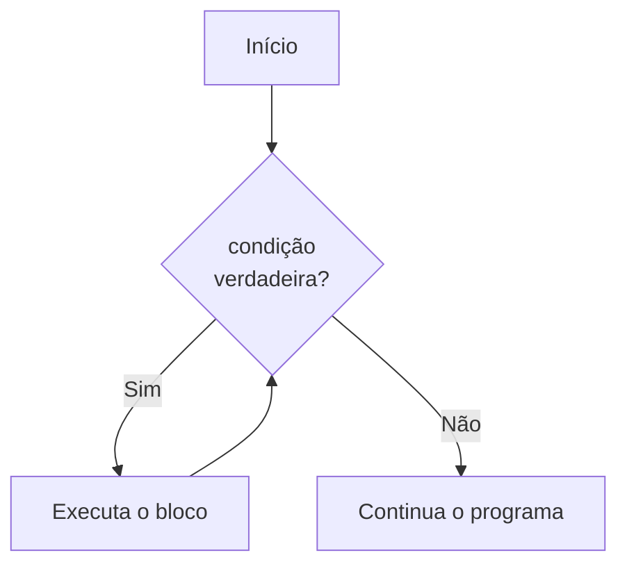

# Estruturas de Repetição

Em [Estruturas Condicionais](./condicionais.md), nosso código decidia **se** um bloco rodava ou não, mas cada bloco ainda rodava **no máximo uma vez**.
As **estruturas de repetição** executam um bloco de código **várias vezes**, enquanto uma condição continuar verdadeira.

Existem dois tipos de problema que pedem uma repetição:

- **Contagem conhecida**: sabemos quantas vezes repetir. Exemplo: somar os números de 1 a 100, ou mostrar a mensagem `#!c "Olá, Mundo"` 50 vezes.
- **Contagem desconhecida**: só sabemos **quando parar**. Exemplo: perguntar uma senha até o usuário acertar, ou descobrir em quantos meses uma poupança dobra de valor.

Copiar e colar o mesmo `#!c printf` cinquente vezes não é prático para o primeiro caso, e é impossível no segundo.

## `#!c while`

A sintaxe do `#!c while` é parecida com a do `#!c if`, só que o fluxo do programa **volta para a condição** ao final do bloco:

```c title="Modelo"
while (condição)
{
    // Roda enquanto "condição" for verdadeira.
}
```



Cada vez que o bloco é executado, falamos que se passou uma **iteração**. Repare que a condição é verificada **antes de cada iteração, inclusive da primeira**. Se ela já começar falsa, o bloco **nunca roda**.

### Um problema de juros

Vamos começar com um problema onde não sabemos quantas repetições são necessárias: uma pessoa quer saber em **quantos meses** sua poupança **duplica de valor**. Essa poupança funciona no regime de **Juros Compostos**.

??? pergunta "Esqueceu como funcionam os Juros Compostos? Aqui está uma revisão!"

    Em uma aplicação de Juros Compostos, você deposita um valor inicial, que **rende** a cada período (como um mês) de acordo com uma taxa $i$. A ideia central é que **o rendimento de um mês passa a fazer parte do valor que rende no mês seguinte**, por isso o nome "composto": o juros também gera juros.

    Vamos pensar em uma aplicação de valor inicial R\$ 100 e taxa de 50% por mês. Chamando de $M$ o valor acumulado **até certo mês**. Com isso, podemos escrever a relação do valor acumulado de um mês em relação ao passado da seguinte forma:

    $$
    \begin{aligned}
    M_0 &= 100 \\
    M_1 &= M_0 \times (1 + 0,5) = \textbf{150} \\
    M_2 &= M_1 \times (1 + 0,5) = \textbf{225} \\
    M_3 &= M_2 \times (1 + 0,5) = \textbf{337,5} \\
    \end{aligned}
    $$

    No nosso programa, a variável `arrecadado` vai ser o $M$, e atualizá-la a cada mês é exatamente a conta $M_n = M_{n-1} \times (1 + i)$ acima. Ou seja, o código **repete** essa conta, mês a mês, em vez de usar uma fórmula pronta.

O valor inicial é de R\$ 1000 e ele rende a uma taxa de 10% ao mês. A meta é o **dobro** do valor inicial. Como esses três valores **nunca mudam**, usamos `#!c const` (e evitamos o valor mágico `#!c 2.0`, dando a ele um nome). Já `arrecadado` e `meses` **vão mudar**, então são variáveis normais:

```c
#include <stdio.h>

int main(void)
{
    const double taxa = 0.1;
    const double valor_inicial = 1000.0;
    const double fator_meta = 2.0;

    const double meta = valor_inicial * fator_meta;

    double arrecadado = valor_inicial;
    int meses = 0;

    // ...

    printf("Demorou %d meses para dobrar!\n", meses);

    return 0;
}
```

Repare que inicializamos `meses` com `#!c 0`, já que ainda não passou nenhum mês e, portanto, `arrecadado` armazena o **valor inicial** da aplicação.

Mas como calculamos essa quantidade de meses? É aqui que o `#!c while` entra. Queremos continuar atualizando `arrecadado` **enquanto** seu valor for **menor que** a `meta`. Escrevemos, **sem a atualização**:

!!! atenção "Não execute esse código ainda!"

    Esse código é só um esqueleto. Ele **ainda não atualiza** nenhuma variável, então rodá-lo causaria um *loop infinito* (veremos isso em breve).

```c hl_lines="14-19"
#include <stdio.h>

int main(void)
{
    const double taxa = 0.1;
    const double valor_inicial = 1000.0;
    const double fator_meta = 2.0;

    const double meta = valor_inicial * fator_meta;

    double arrecadado = valor_inicial;
    int meses = 0;

    while (arrecadado < meta)
    {
        // ...

        printf("Mês %d: R$ %.2f\n", meses, arrecadado);
    }

    printf("Demorou %d meses para dobrar!\n", meses);

    return 0;
}
```

Para atualizar o valor arrecadado, fazemos a seguinte operação: `#!c arrecadado = arrecadado * (1.0 + taxa)`. O valor arrecadado **antigo** é multiplicado pelo fator de aumento (`#!c (1.0 + taxa)`) e guardado de volta na mesma variável. Como essa atualização ocorre **uma vez por mês**, também incrementamos a variável `meses`: `#!c meses = meses + 1`. O código final fica assim:

```c hl_lines="16-17"
#include <stdio.h>

int main(void)
{
    const double taxa = 0.1;
    const double valor_inicial = 1000.0;
    const double fator_meta = 2.0;

    const double meta = valor_inicial * fator_meta;

    double arrecadado = valor_inicial;
    int meses = 0;

    while (arrecadado < meta)
    {
        arrecadado = arrecadado * (1.0 + taxa);
        meses = meses + 1;

        printf("Mês %d: R$ %.2f\n", meses, arrecadado);
    }

    printf("Demorou %d meses para dobrar!\n", meses);

    return 0;
}
```

Essa é a saída do programa:

```console hl_lines="10"
$ ./main
Mês 1: R$ 1100.00
Mês 2: R$ 1210.00
Mês 3: R$ 1331.00
Mês 4: R$ 1464.10
Mês 5: R$ 1610.51
Mês 6: R$ 1771.56
Mês 7: R$ 1948.72
Mês 8: R$ 2143.59
Demorou 8 meses para dobrar!
```

A tabela a seguir mostra o valor de `arrecadado` antes da iteração, o resultado da condição, o valor atualizado e o mês, respectivamente. Os valores estão arredondados em duas casas decimais.

| Iteração | `arrecadado` (antes) | `#!c arrecadado < meta`? | **`arrecadado` (depois)** | meses |
| :-: | :-: | :-: | :-: | :-: |
| 1 | `#!c 1000.0` | Sim, `#!c 1000.0 < 2000.0` | `#!c 1100.0` | 1 |
| 2 | `#!c 1100.0` | Sim, `#!c 1100.0 < 2000.0` | `#!c 1210.0` | 2 |
| 3 | `#!c 1210.0` | Sim, `#!c 1210.0 < 2000.0` | `#!c 1331.0` | 3 |
| ... | ... | ... | ... | ... |
| 7 | `#!c 1771.56` | Sim, `#!c 1771.56 < 2000.0` | `#!c 1948.72` | 7 |
| 8 | `#!c 1948.72` | Sim, `#!c 1948.72 < 2000.0` | **`#!c 2143.59`** | 8 |
| - | `#!c 2143.59` | **Não, `#!c 2143.59 < 2000.0`!** | **fim do loop (nada executado)** | 8 |

Na última linha, a condição é falsa e o bloco **não executa**; o programa segue para o `#!c printf` final.

!!! nota

    Troque `fator_meta` por `#!c 0.5` e perceba que o `#!c while` **não é executado**. A meta passa a ser R\$ 500, e `arrecadado` **já começa** maior que ela, por isso a condição falha e o código continua.

### Acumulador e contador

Repare que o programa tem duas variáveis que mudam a cada iteração, mas com **papéis diferentes**:

- `arrecadado` é um **acumulador**: ela guarda um resultado que vai sendo construído a cada iteração.
- `meses` é um **contador**: ela só registra **quantas iterações** já aconteceram.

Esses dois papéis aparecem em quase toda repetição, e vale a pena reconhecê-los. No problema dos juros, a **condição** do `#!c while` depende do acumulador (`arrecadado < meta`), mas sem sempre esse é o caso.

### Loop infinito

Vamos voltar nossa atenção para o código **sem atualizar** `arrecadado`:

```c hl_lines="16"
#include <stdio.h>

int main(void)
{
    const double taxa = 0.1;
    const double valor_inicial = 1000.0;
    const double fator_meta = 2.0;

    const double meta = valor_inicial * fator_meta;

    double arrecadado = valor_inicial;
    int meses = 0;

    while (arrecadado < meta)
    {
        // Remoção da atualização de arrecadado

        meses = meses + 1;

        printf("Mês %d: R$ %.2f\n", meses, arrecadado);
    }

    printf("Demorou %d meses para dobrar!\n", meses);

    return 0;
}
```

Como as variáveis que fazem parte da condição do `#!c while` **não são** atualizadas, `arrecadado` **sempre** será menor que `meta`. O vídeo a seguir demonstra como o programa se comporta:

???+ exemplo "Vídeo de Exemplo"

    <video class="so-claro" autoplay loop muted playsinline>
      <source src="../../assets/videos/repeticao/loop-infinito-claro.webm" type="video/webm">
    </video>
    <video class="so-escuro" autoplay loop muted playsinline>
      <source src="../../assets/videos/repeticao/loop-infinito-escuro.webm" type="video/webm">
    </video>

Como a condição é **sempre verdadeira**, o bloco de código não para de ser executado; com isso a variável `meses` é incrementada e a mensagem exibida inúmeras vezes. Damos o nome de **loop infinito** a essa falha, onde *loop* se refere às estruturas de repetição, nesse caso o `#!c while`. Para terminar o programa, apertamos o atalho ++ctrl+c++.

#### Um loop infinito mais traiçoeiro

Esquecer a atualização não é a única forma de cair em um loop infinito. Restaure a linha `#!c arrecadado = arrecadado * (1.0 + taxa);` e troque a taxa por `#!c 0.0`:

```c
const double taxa = 0.0;
```

Agora a atualização **existe**, mas ela multiplica `arrecadado` por `#!c 1.0`, que **não muda nada**. O valor fica preso em R\$ 1000, e a meta nunca é alcançada.

Para evitar esse erro, **toda iteração deve aproximar a condição de se tornar falsa**. Quando isso não está garantido pelos valores de entrada (como uma taxa zero ou negativa), o programa fica vulnerável a um loop infinito.

## Praticando o `#!c while`

### Soma de 1 a 100

Agora resolva o seguinte problema: some os números de 1 a 100 usando o `#!c while`, isso é, calcule $1 + 2 + 3 + \dots + 99 + 100$. Esse problema mostra outra força das estruturas de repetição: repetir um trecho de código **uma quantidade conhecida de vezes**. No modelo a seguir, os comentários `#!c /* ... */` mostram o que precisa ser preenchido:

```c
#include <stdio.h>

int main(void)
{
    const int comeco = 1;
    const int fim = 100;

    int soma = /* ... */;

    /* ... */

    while (/* ... */)
    {
        /* ... */
    }

    printf("Soma dos números de %d a %d:\n", comeco, fim);
    printf("%d\n", soma);

    return 0;
}
```

Essa é a saída esperada:

```console
$ ./main
Soma dos números de 1 a 100:
5050
```

??? dica

    Identifique quem é o **acumulador** e quem é o **contador**. Qual deles aparece na condição do `#!c while`? E quando o contador deve **parar**: antes ou depois de chegar em `fim`?

    Se tiver dúvida sobre o valor inicial do acumulador, releia [Inicialização](./variaveis.md#inicializacao).

??? resposta

    Começamos pelas variáveis. A `soma` é o **acumulador**, e como não somamos nada ainda, ela começa em `#!c 0`. Se ela não fosse inicializada, guardaria **lixo de memória**, e o resultado final seria imprevisível. Já o contador, que percorre os números de `comeco` até `fim`, começa em `comeco`:

    ```c
    int soma = 0;

    int contador = comeco;
    ```

    Queremos que o `fim` **também seja somado**, então o `#!c while` deve rodar **enquanto** `contador` for **menor ou igual** a `fim`. Dentro do bloco, somamos o contador ao acumulador e **avançamos o contador** (sem essa atualização teríamos um loop infinito):

    ```c hl_lines="8 10 12 14 16"
    #include <stdio.h>

    int main(void)
    {
        const int comeco = 1;
        const int fim = 100;

        int soma = 0;

        int contador = comeco;

        while (contador <= fim)
        {
            soma = soma + contador;

            contador = contador + 1;
        }

        printf("Soma dos números de %d a %d:\n", comeco, fim);
        printf("%d\n", soma);

        return 0;
    }
    ```

### Um passo a menos

Volte à solução anterior e troque o `#!c <=` por `#!c <` na condição do `#!c while`. **Antes de rodar**, preveja qual será a saída.

??? dica

    Qual é o **último valor** que o contador assume agora? O `fim` ainda é somado?

??? resposta

    A saída é `4950`. Com o `#!c <`, o `#!c while` termina assim que `contador` vale `#!c 100`, então o último valor somado é `#!c 99`, e o `#!c 100` fica de fora: $5050 - 100 = 4950$.

    Esse erro é tão comum que tem nome: ***off-by-one***, do inglês "errado por um". Ele aparece sempre que confundimos "menor que" com "menor ou igual", e o programa **compila e roda sem nenhum aviso**, só entrega um resultado levemente errado.

### Prevendo a saída

Sem compilar, diga o que os trechos a seguir imprimem. Rastrear o código **na mão**, como fizemos na tabela de iterações, pode te ajudar a prevêr a saída.

```c title="Trecho A"
int n = 10;

while (n > 0)
{
    printf("%d ", n);

    n = n - 3;
}

printf("\n");

printf("n vale %d\n", n);
```

```c title="Trecho B"
int x = 1;

while (x < 100)
{
    x = x * 2;
}

printf("x vale %d\n", x);
```

??? resposta

    **Trecho A**

    ```
    10 7 4 1
    n vale -2
    ```

    O `n` começa em `#!c 10`, e a cada iteração diminui `#!c 3`: o `#!c 10`, o `#!c 7`, o `#!c 4` e o `#!c 1` são impressos. Depois do `#!c 1`, `n` vira `#!c -2`, a condição `#!c -2 > 0` é falsa e o loop termina. Repare que o `#!c -2` **nunca é impresso dentro do loop**, mas **é** o valor final de `n`.

    **Trecho B**

    ```
    x vale 128
    ```

    `x` percorre `#!c 1`, `#!c 2`, `#!c 4`, `#!c 8`, `#!c 16`, `#!c 32`, `#!c 64` e `#!c 128`. Com `x` valendo `#!c 64`, a condição `#!c 64 < 100` ainda é verdadeira, então ele dobra mais uma vez e **ultrapassa** `#!c 100`. O `#!c while` só percebe isso **na próxima verificação**.

### Múltiplos de 3 ou 5

Esse exercício **não tem modelo**: some todos os números **menores que 1000** que sejam múltiplos de `#!c 3` **ou** de `#!c 5`. Use o que vimos em [Condicionais](./condicionais.md): o operador módulo (`#!c %`) e o "OU" (`#!c ||`).

A saída esperada é:

```console
$ ./main
Soma dos múltiplos de 3 ou 5 menores que 1000:
233168
```

??? dica

    Um número é múltiplo de `#!c 3` quando o **resto** da divisão dele por `#!c 3` vale `#!c 0`. Você vai precisar de um `#!c if` (ou de uma variável `#!c bool`) **dentro** do `#!c while`. Atenção: a atualização do contador **não** pode ficar dentro do `#!c if`. Por quê?

??? resposta

    Esse problema une as duas ideias que vimos: o `#!c while` percorre os números, e o `#!c if` decide **quais** entram na soma. Como em [Condicionais](./condicionais.md), damos um nome à condição:

    ```c hl_lines="16-19 21-24"
    #include <stdbool.h>
    #include <stdio.h>

    int main(void)
    {
        const int limite = 1000;

        int soma = 0;
        int contador = 1;

        while (contador < limite)
        {
            bool eh_multiplo = (contador % 3 == 0) || (contador % 5 == 0);

            if (eh_multiplo)
            {
                soma = soma + contador;
            }

            contador = contador + 1;
        }

        printf("Soma dos múltiplos de %d ou %d menores que %d:\n", primeiro_divisor, segundo_divisor, limite);
        printf("%d\n", soma);

        return 0;
    }
    ```

    A atualização do contador fica **fora** do `#!c if`, já que ele precisa avançar **sempre**. Se estivesse dentro, ele só avançaria nos múltiplos, e no primeiro número que **não** fosse múltiplo (como o `#!c 1`) o programa entraria em um loop infinito.

### Sequência de Collatz

Os exercícios anteriores têm algo em comum: já sabíamos **quantas iterações** teríamos, ou ao menos tínhamos como calcular. Agora, um problema de **contagem desconhecida**, como os juros.

Dado um número inteiro **positivo**, aplique repetidamente a regra a seguir **até chegar em 1**:

- Se o número for **par**, divida-o por 2.
- Se o número for **ímpar**, multiplique-o por 3 e some 1.

Conte quantos **passos** foram necessários. Por exemplo, partindo do `#!c 6` a sequência é `#!c 6 → 3 → 10 → 5 → 16 → 8 → 4 → 2 → 1`, ou seja, 8 passos.

```c
#include <stdio.h>

int main(void)
{
    // Entrada:

    const int numero_inicial = 27;

    // Saída:

    return 0;
}
```

Para `#!c 27`, a saída esperada é:

```console
$ ./main
Começando em 27, chegou em 1 após 111 passos.
```

!!! atenção

    Se você errar a condição do `#!c while`, o programa cai em um loop infinito. Use ++ctrl+c++ para interrompê-lo. Teste **apenas** com números positivos: com `#!c 0`, o número é par, `#!c 0 / 2` vale `#!c 0` e o loop **nunca** termina.

??? dica

    Você precisa de um **contador** (`passos`) e de uma variável que **muda** a cada iteração (o número atual). Por que não podemos alterar a `numero_inicial` diretamente? Qual é a condição para o loop **continuar**?

??? resposta

    Como `numero_inicial` é constante, criamos uma variável `atual` para acompanhar a sequência. O loop continua **enquanto** `atual` for **diferente** de `#!c 1`. Dentro dele, um `#!c if` escolhe a regra e o contador registra o passo:

    ```c
    #include <stdio.h>

    int main(void)
    {
        // Entrada:

        const int numero_inicial = 27;

        // Saída:

        int atual = numero_inicial;
        int passos = 0;

        while (atual != 1)
        {
            if (atual % 2 == 0)
            {
                atual = atual / 2;
            }
            else
            {
                atual = atual * 3 + 1;
            }

            passos = passos + 1;
        }

        printf("Começando em %d, chegou em %d após %d passos.\n", numero_inicial, destino, passos);

        return 0;
    }
    ```

    Nesse problema **não há como saber** quantas iterações teremos sem executar o programa. A sequência de `#!c 27`, por exemplo, sobe até `#!c 9232` antes de descer. Ainda mais curioso: ninguém conseguiu provar que **todo** número positivo chega em `#!c 1`. Essa é a famosa *Conjectura de Collatz*, um problema em aberto da matemática. Para quem quiser um desafio extra: modifique o programa para também mostrar o **maior valor** atingido na sequência (para `#!c 27`, são `#!c 9232`).

---

Repare que, na soma de 1 a 100, os três elementos de uma repetição por contagem ficaram **espalhados** pelo código: a inicialização do contador (`#!c int contador = comeco;`), a condição (`#!c contador <= fim`) e a atualização (`#!c contador = contador + 1;`). Como esse padrão é muito comum, o C oferece uma estrutura que os coloca **juntos, em uma única linha**. É o que veremos a seguir.

## for

Para entendermos o porquê da estrutura de repetição `for` existir, vamos criar um contador de 1 até 10 usando o `while`.

```c
int indice = 1;
while (indice != 10)
{
    printf("Índice atual: %d\n", indice);

    indice++;
}
```

1. **Inicialização** antes do `#!c while` *loop*. É a declaração da variável `indice` com o **valor inicial** de `#!c 1`.
2. **Condição** dentro do `#!c while`. É quando comparamos o valor atual da variável `indice` com `#!c 10`.
3. **Atualização** ao final do `#!c while`. Usamos da sintaxe `indice++` para indicar que estamos incrementando a variável `indice` em um. Essa parte é essencial para impedir um **loop infinito**. Note que poderíamos ter usado `#!c indice += 1` ou `#!c indice = indice + 1` também.

O erro está aqui: o contador só vai até nove! Para entendermos o porquê disso, vamos verificar o resultado da condição `indice != 10` para todos os valores de `indice`, até que a condição se torne falsa. Lembre-se de que o `printf` só irá **mostrar o índice** atual **se a condição for verdadeira**, caso contrário, nada será impresso no terminal.

| indice | indice != 10            |
| :----: | :---------------------- |
|   1    | `1 != 10` => Verdadeiro |
|   2    | `2 != 10` => Verdadeiro |
|   3    | `3 != 10` => Verdadeiro |
|  ...   | ...                     |
|   8    | `8 != 10` => Verdadeiro |
|   9    | `9 != 10` => Verdadeiro |
| **10** | `10 != 10` => **Falso** |

Na última linha da tabela, o valor de `indice` é 10. Dessa forma, a condição `10 != 10` é falsa, já que 10 é igual a 10.

Para consertar esse erro, vamos usar da desigualdade **menor ou igual**, escrita como `<=`. O programa ficará assim:

```c
int indice = 1;
while (indice <= 10)
{
    printf("Índice atual: %d\n", indice);

    indice++;
}

return 0;
```

Lemos o `while` da seguinte maneira: enquanto o `indice` for **menor ou igual** a 10 imprima o índice atual e incremente a variável `indice` em 1.

Agora, vamos ver um jeito mais simples de escrever essa mesma lógica, usando um `for` *loop*. Essa estrutura de repetição junta a **inicialização**, a **condição** e o **incremento** em uma única linha, facilitando a leitura e eliminando erros, como esquecer de incrementar o índice ao final do *loop*.
O mesmo programa acima pode ser escrito nesse novo formato:

```c
for (int indice = 1; indice <= 10; indice++)
{
    printf("Índice atual: %d\n", indice);
}
```

Por último, vamos criar um programa que imprime a tabuada de um número.

Primeiro, vamos criar uma variável global chamada `total`, que armazenará o total de números da tabuada, que são `10`.

> Escreva o código dentro da função `main`. Não se esqueça de importar o header `stdio` e retornar `0` ao final de `main`.

```c
const int total = 10;
```

Depois, vamos perguntar ao usuário de qual número será a tabuada.

```c
int numero = 0;
printf("Digite um número para saber sua tabuada: ");
scanf("%d", &numero);
```

E agora, vamos criar o *loop* que vai exibir a tabuada.

```c
for (int indice = 1; indice <= total; indice++)
{
    int resultado = numero * indice;
    printf("%d x %d = %d\n", numero, indice, resultado);
}
```
